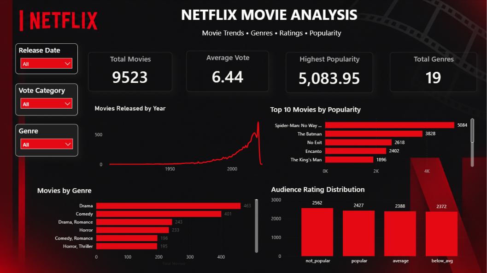

# 🎬 Netflix Movie Analysis & Power BI Dashboard

An end-to-end movie data analysis project using Python and Power BI to explore movie ratings, popularity, genres, and release trends.

## 📊 Dashboard Preview



## 📌 Project Overview

This project analyzes movie data using Python and presents the findings through an interactive Power BI dashboard.

The project covers data exploration, cleaning, statistical analysis, visualization, and dashboard development.

## 🛠️ Tools & Technologies

- Python
- Pandas
- NumPy
- Matplotlib
- Seaborn
- Jupyter Notebook
- Power BI
- DAX

## 🔍 Analysis Performed

### Python Analysis

- Dataset exploration and understanding
- Data cleaning and preprocessing
- Duplicate and missing-value analysis
- Movie popularity analysis
- Audience rating analysis
- Genre analysis
- Release year analysis
- Data visualization

### Power BI Dashboard

The dashboard provides:

- Total Movies
- Average Vote
- Highest Popularity
- Total Genres
- Movies Released by Year
- Top 10 Movies by Popularity
- Movies by Genre
- Audience Rating Distribution

### Interactive Filters

- Release Date
- Genre
- Vote Category

## 📈 Dashboard Metrics

| Metric | Value |
|---|---:|
| Total Movies | 9,523 |
| Average Vote | 6.44 |
| Highest Popularity | 5,083.95 |
| Total Genres | 19 |

## 📂 Project Structure

```text
Netflix-Movie-Analysis/
│
├── Netflix_Movie_Analysis.ipynb
├── mymoviedb.csv
├── Netflix_Movie_Analysis_Dashboard.pbix
├── Netflix_Movie_Analysis_Dashboard.png
└── README.md
